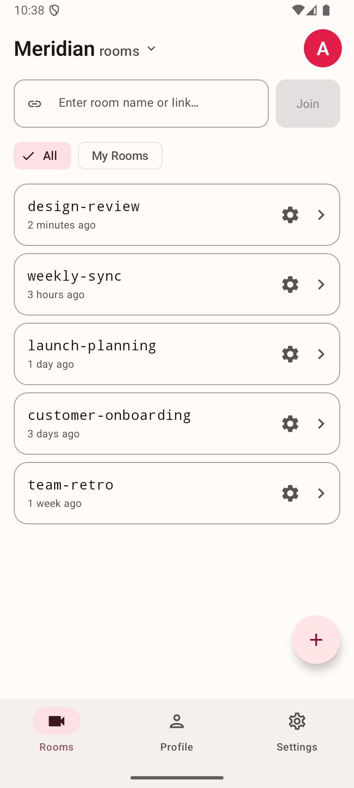
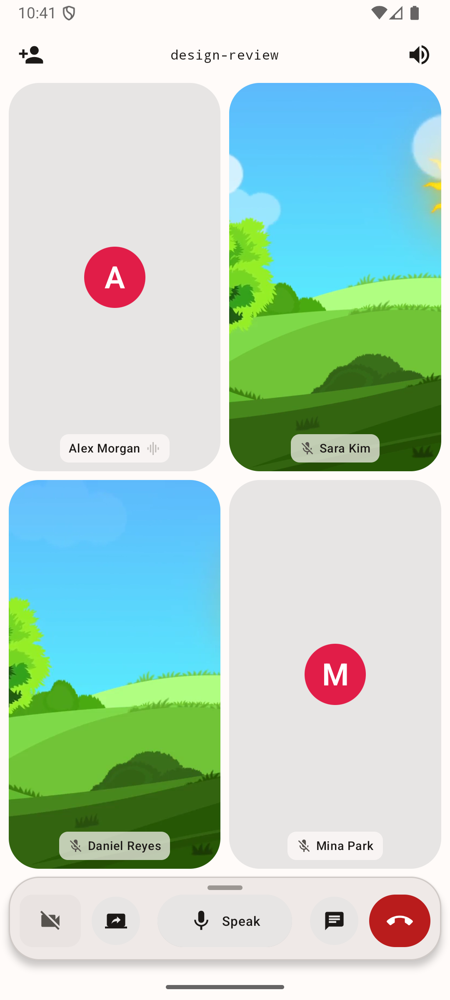
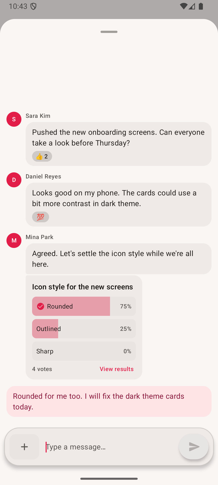
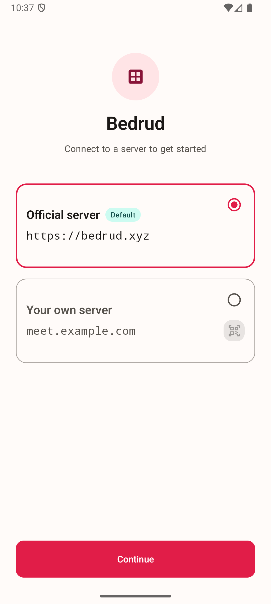

<div align="center">


# Bedrud for Android

The Android app for [Bedrud](https://github.com/themadorg/bedrud), the self-hosted video meeting platform.

[](https://github.com/themadorg/bedrud-android/releases/latest)
[](#download)
[](LICENSE)

[bedrud.org](https://bedrud.org/en/) ·
[Releases](https://github.com/themadorg/bedrud-android/releases) ·
[Report a bug](https://github.com/themadorg/bedrud-android/issues)






</div>

Bedrud is a video meeting platform you run on your own server. This app connects to any Bedrud
server, yours or the official one at bedrud.xyz, and keeps several side by side, each with its own
sign-in.

## Features

### Calls

- Video and audio calls over [LiveKit](https://livekit.io)
- Calls run as phone calls: they keep going in the background, offer mute and hang-up in the
  notification, and play through the earpiece, speaker, a wired headset or Bluetooth
- Picture-in-picture that shows whoever is speaking, with mute and hang-up on the window
- Screen sharing, with several people presenting at once and each viewer choosing what to watch
- Push to talk, an adjustable voice gate, per-person volume and noise suppression
- Deafen, which silences the whole call in one tap
- On the earpiece, the screen turns off while the phone is at your ear
- A sound when someone joins or leaves, and when a message arrives
- Your own rooms can be started again after their call ends, under the same link

### Chat

- Messages, emoji reactions, polls and images, during the call
- Copy or share any message, and save a received image to the gallery
- A link to a room on one of your servers takes you there, once you confirm leaving this call
- A room's owner can turn chat off for it

### Servers and accounts

- Add a server by typing its address or scanning its QR code, and switch between servers from the
  rooms screen
- Remove a server, along with its saved sign-in and recent rooms
- Sign in with email and password, a passkey, OAuth, or as a guest; sign up and reset a forgotten
  password where the server allows it
- Room hosts can remove or ban people from a call
- A server's superadmin gets an Admin tab: users, rooms, people online, bans, and the server's
  sign-up and invite settings

### Everything else

- 10 languages, with right-to-left layouts for Arabic and Persian
- Light, dark, or the system's theme
- Sign-in tokens are encrypted with a key held in the Android Keystore
- Settings › About lists every open-source library the app ships, with its license

## Download

Get the APK from the [latest release](https://github.com/themadorg/bedrud-android/releases/latest).
`bedrud-arm64-v8a.apk` fits most current phones; if you are not sure, take
`bedrud-universal.apk`, which runs on any. The app needs Android 9 or newer.

On first launch, pick the official server or enter the address of your own.

## Run your own server

The server is a single binary holding the web app, the API and the LiveKit media server. How to
install it is in the [main Bedrud repository](https://github.com/themadorg/bedrud) and its
[documentation](https://bedrud.org/en/docs/).

## Build from source

You need JDK 17 and the Android SDK; [Android Studio](https://developer.android.com/studio) brings
both.

```bash
git clone https://github.com/themadorg/bedrud-android.git
cd bedrud-android
./gradlew assembleDebug
```

[CONTRIBUTING.md](CONTRIBUTING.md) covers the tests, the `make` shortcuts, build options, release
builds and how a release is cut.

## Contributing

Bug reports and pull requests are welcome. Start with [CONTRIBUTING.md](CONTRIBUTING.md);
[ARCHITECTURE.md](ARCHITECTURE.md) maps how the app fits together, [DESIGN.md](DESIGN.md) describes
its design system, and [AGENTS.md](AGENTS.md) holds the conventions in detail.

The server, the web app and the other clients live in the
[main Bedrud repository](https://github.com/themadorg/bedrud), and their issues belong there.

## License

[Apache 2.0](LICENSE). See [NOTICE](NOTICE) for attributions.
